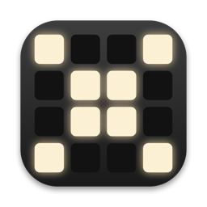
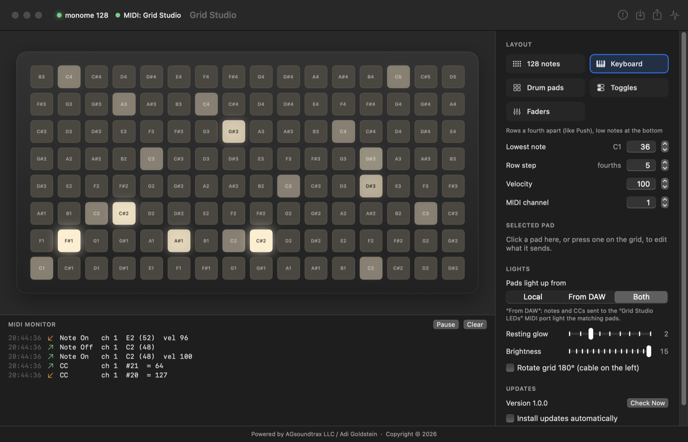
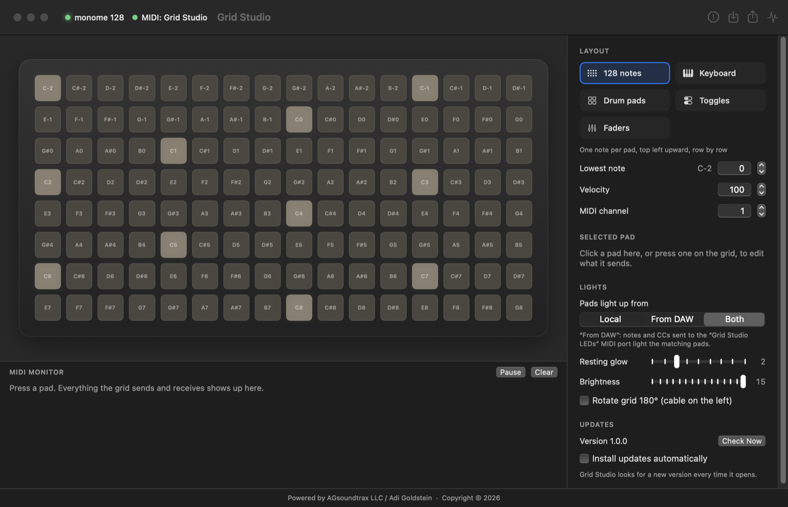
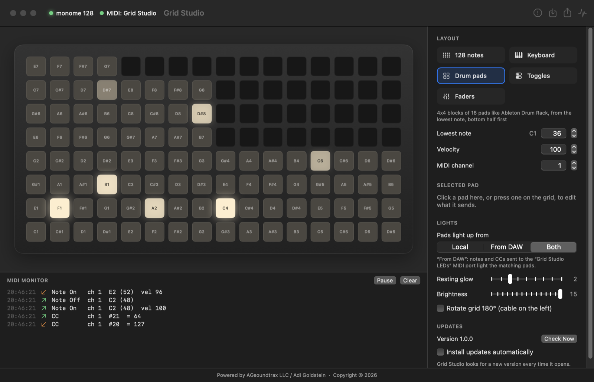
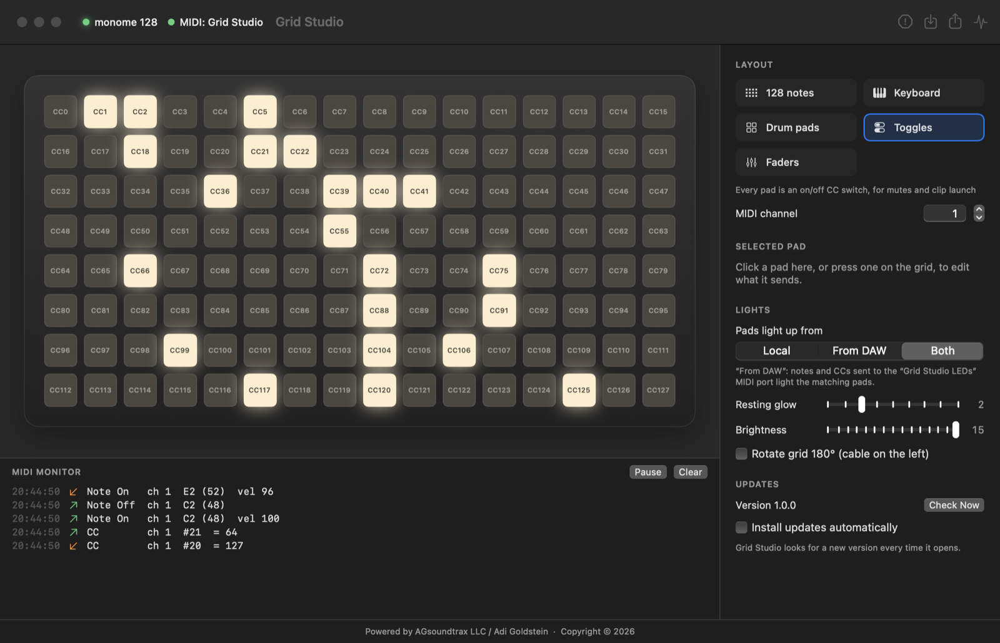
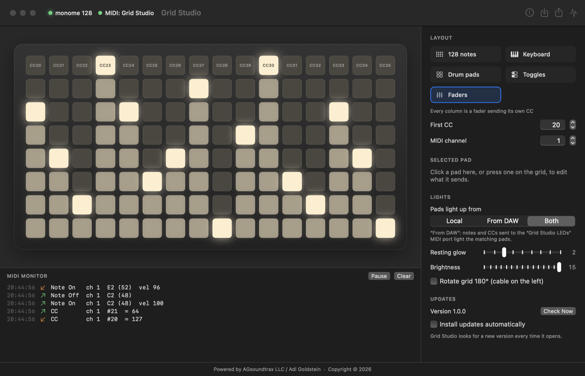
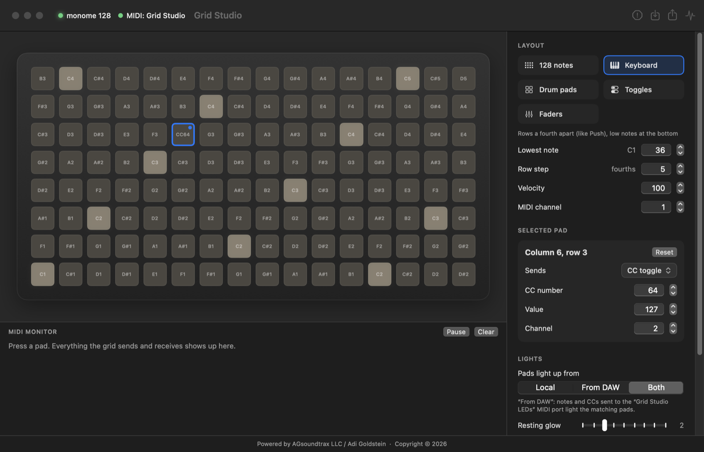
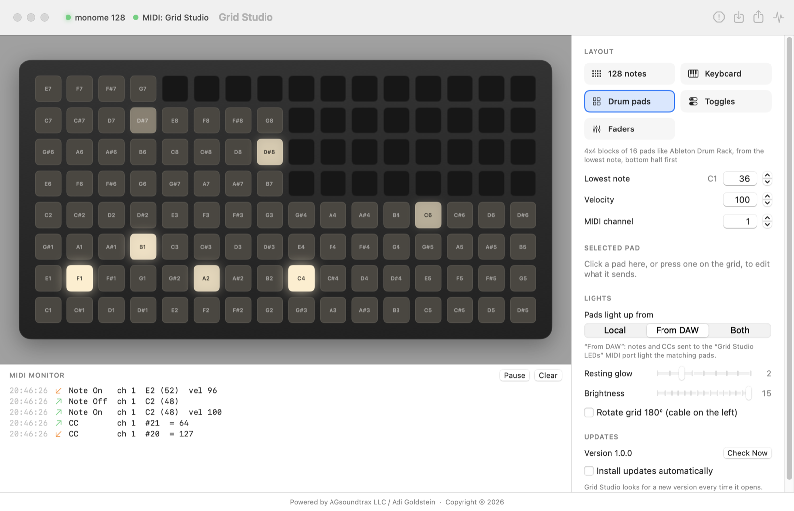

<p align="center">
  
</p>

<h1 align="center">Grid Studio</h1>

<p align="center">
  <b>Turn your monome grid into a MIDI controller on the Mac.</b><br>
  A native macOS app with its own grid driver. No serialosc, no Max, no setup.<br>
  Plug in the grid, open Grid Studio, pick “Grid Studio” as a MIDI input in your DAW. Done.
</p>

<p align="center">
  <a href="https://github.com/adigold/GridStudio/releases/latest"><b>Download for macOS</b></a> ·
  <a href="#install">Homebrew</a> ·
  <a href="#the-layouts">Layouts</a> ·
  <a href="#editing-a-pad">Pad editor</a> ·
  <a href="#lights-and-led-feedback">LED feedback</a> ·
  <a href="#automatic-updates">Updates</a> ·
  <a href="#build-from-source">Build</a>
</p>



## What it does

- **Shows up as a real MIDI device.** Grid Studio publishes a CoreMIDI port called **Grid Studio**. Ableton Live, Logic Pro, Bitwig, Reaper, MainStage, GarageBand and anything else that takes MIDI input sees it right away.
- **Lights follow your DAW.** A second port, **Grid Studio LEDs**, works the other way: notes and CCs your DAW sends to it light up the matching pads, with the brightness taken from the velocity or CC value.
- **Five layouts, one click each.** Keyboard, 128 notes, Drum pads, Toggles and Faders.
- **Every pad is editable.** Click any pad and make it a note, a note toggle, a CC, a CC toggle, a fader or nothing, on any channel.
- **Talks to the grid directly.** A built in driver speaks the monome serial protocol over USB, so you do not need serialosc. It finds the grid on its own and reconnects when you plug it back in.
- **Live mirror on screen.** The window shows exactly what the grid shows, 16 brightness levels per pad. You can play the pads with the mouse too, handy when the grid is not plugged in.
- **MIDI monitor.** Every message in and out, with time, direction, channel, note name and value.
- **Save and share mappings** as small JSON files.
- **Lives in the menu bar.** Close the window and it keeps running. Quitting turns every LED off.
- **Updates itself.** On launch it checks for a new version and offers it, or installs it for you.

Tested with a monome grid 128 (16 x 8). The driver reads the grid's size when it connects, so 64 (8 x 8) and 256 (16 x 16) grids should work through the same code, but they have not been tested yet. Reports welcome.

## Install

**With Homebrew:**

```sh
brew tap adigold/gridstudio
brew trust adigold/gridstudio
brew install --cask grid-studio
```

**Or by hand:**

1. Download the latest `Grid-Studio-x.y.z.zip` from [Releases](https://github.com/adigold/GridStudio/releases/latest).
2. Unzip it and drag **Grid Studio** into your Applications folder.
3. Plug in your grid and open Grid Studio. The dot at the top left turns green and shows the grid's name (for example *monome 128*).

Requires macOS 14 Sonoma or newer. Runs natively on Apple silicon and Intel.

**Note:** only one app can talk to the grid at a time. If serialosc or Max is running and holding the grid, quit it first. Grid Studio keeps looking and connects as soon as the grid is free.

## Using it in your DAW

**Ableton Live:** Settings → Link, Tempo & MIDI. Under MIDI Ports, turn on **Track** (and **Remote** if you want to MIDI map controls) for the input *Grid Studio*. To get LED feedback, turn on **Track** for the output *Grid Studio LEDs*, then set a MIDI track's output to *Grid Studio LEDs*.

**Logic Pro:** Logic sees all MIDI inputs by default. Play the grid and it records. For LED feedback, set an External MIDI track's output to *Grid Studio LEDs*.

**Bitwig, Reaper, others:** add *Grid Studio* as a generic MIDI keyboard / input, and *Grid Studio LEDs* as an output if you want the pads to light from the DAW.

## The layouts

Pick a layout at the top of the right panel. Every layout uses the **MIDI channel** set below it.

### Keyboard


An isomorphic keyboard like Ableton Push: every row is a fourth (5 semitones) above the one below, low notes at the bottom left. Every C glows a little brighter so you can find your way. Change the **Lowest note**, the **Row step** (5 = fourths, 7 = fifths, anything from 1 to 12) and the **Velocity**.

### 128 notes



All 128 MIDI notes, one per pad, from note 0 at the top left, left to right, row by row. Great for triggering samples, scenes or anything addressed by note number. Choosing this layout sets the lowest note to 0 so all 128 fit.

### Drum pads



Blocks of 4 x 4 pads, laid out like Ableton's Drum Rack: the bottom left block starts at the lowest note (C1 = 36 by default), each block is the next 16 notes, bottom half first, then the top half. Pads past note 127 are switched off.

### Toggles



Every pad is an on/off switch that sends a CC: press once for 127, again for 0. The top left pad is CC 0 and the numbers count left to right, row by row up to CC 127. Perfect for mutes, solos, arms and clip launch with MIDI mapping. Lit pads are on.

### Faders



Every column is a fader with its own CC, starting at **First CC** (20 by default, so the columns send CC 20 to 35). Press a pad to jump the fader there: the top row sends 127, the bottom row 0. The column lights up from the bottom to the current value. When your DAW sends that CC back to *Grid Studio LEDs*, the fader moves to match.

## Editing a pad



Click a pad in the window, or press one on the grid, and the **Selected pad** panel shows what it sends. Change any of it and that pad keeps your setting whatever layout you are on. Edited pads have a small blue dot.

| Sends | What it does |
| --- | --- |
| Note | Note on while held, note off on release |
| Note toggle | Press once for note on, again for note off |
| CC | Sends the value while held, 0 on release |
| CC toggle | Press to switch between the value and 0 |
| Fader (column) | The column is a fader, the row sets the value |
| Off | Sends nothing |

For each pad you set the note or CC number (the note name is shown next to it), the velocity or value, and the channel. **Reset** puts the pad back to what the layout gives it. **Grid → Reset All Pad Edits** (⇧⌘⌫) clears every edit.

## Lights and LED feedback



**Pads light up from** decides who controls the LEDs:

- **Local:** pads light while you hold them, and toggles stay lit while on.
- **From DAW:** only MIDI sent to *Grid Studio LEDs* lights the pads. A note on lights every pad mapped to that note and channel, brightness from the velocity. Note off turns it off. A CC does the same for CC pads, and moves faders.
- **Both:** both at once (the default).

**Resting glow** is how bright mapped pads are when idle (0 turns them fully dark). **Brightness** is the grid's overall LED intensity. **Rotate grid 180°** flips everything for when the cable points left. The window always shows the grid the right way up.

## Saving and sharing mappings

Your current setup is saved automatically and comes back the next time you open the app.

- **⌘S** saves the mapping to a `.json` file.
- **⌘O** opens one.

A mapping file holds the layout, its settings, the light settings and every pad edit, so you can keep one per project or share it with a friend.

## Keyboard shortcuts

| Shortcut | Action |
| --- | --- |
| ⌘. | All Notes Off on every channel (panic) |
| ⌘S / ⌘O | Save / open a mapping |
| ⇧⌘M | Show or hide the MIDI monitor |
| ⌥⌘R | Rotate the grid 180° |
| ⇧⌘⌫ | Reset all pad edits |

## Automatic updates

Grid Studio uses [Sparkle](https://sparkle-project.org), the standard updater for Mac apps.

- Every time the app opens it reads [`appcast.xml`](appcast.xml) from this repository (and again every hour while it runs).
- If a newer version is listed, you get the update window with the release notes and an **Install Update** button. Turn on **Install updates automatically** in the Updates section and it downloads in the background and installs when you quit.
- You can always check by hand: **Grid Studio → Check for Updates…**, or from the menu bar icon.
- Every update is signed. The app only installs a download whose EdDSA signature matches the public key built into it, and whose code signature comes from the same developer, so nobody else can push an update to your Mac.

## How it works

```
 monome grid ──USB serial──▶ GridDevice ──▶ Controller ──▶ MIDIEngine ──▶ "Grid Studio" ──▶ your DAW
   (LEDs)    ◀─────────────  (driver)   ◀── (mapping, ◀──  (CoreMIDI)  ◀── "Grid Studio LEDs" ◀──┘
                                             lights)
```

| File | What it does |
| --- | --- |
| [`GridDevice.swift`](Sources/GridStudio/GridDevice.swift) | The grid driver. Finds `/dev/cu.usbmodemm*` (or `cu.usbserial-m*` on older grids), opens it with exclusive access at 115200 baud, asks for the id, size and firmware, parses key presses and sends LEDs as 8 x 8 level maps 60 times a second, only when something changed. Reconnects every 1.5 s when the grid is unplugged. |
| [`MIDIEngine.swift`](Sources/GridStudio/MIDIEngine.swift) | Creates the virtual CoreMIDI source and destination with stable IDs so your DAW remembers them, and sends and receives MIDI 1.0 as Universal MIDI Packets. |
| [`Mapping.swift`](Sources/GridStudio/Mapping.swift) | Layouts, pad types and the saved profile. |
| [`Controller.swift`](Sources/GridStudio/Controller.swift) | Turns key presses into MIDI, incoming MIDI into lights, and draws the LED frame for both the grid and the window. |
| [`Updater.swift`](Sources/GridStudio/Updater.swift) | Sparkle setup. |
| `*View.swift`, `App.swift` | The SwiftUI interface and the menu bar item. |

The grid speaks the monome serial protocol, documented at [monome.org/docs/serialosc/serial.txt](https://monome.org/docs/serialosc/serial.txt). The messages Grid Studio uses:

| Direction | Bytes | Meaning |
| --- | --- | --- |
| to grid | `00` / `01` / `05` / `0F` | ask for capabilities / id / size / firmware |
| to grid | `17 i` | global intensity 0 to 15 |
| to grid | `1A x y` + 32 bytes | set an 8 x 8 block, 4 bits per LED |
| to grid | `12` | all LEDs off (sent on quit) |
| from grid | `20 x y` / `21 x y` | key up / key down |
| from grid | `01` + 32 bytes, `03 x y` | device id, grid size |

## Build from source

You need Xcode 15.3 or newer (or its command line tools) on macOS 14+.

```sh
git clone https://github.com/adigold/GridStudio.git
cd GridStudio
./scripts/build-app.sh          # writes build/Grid Studio.app
open "build/Grid Studio.app"
```

The script builds a universal binary, embeds Sparkle and signs everything with the first *Developer ID Application* certificate in your keychain. Without one it signs ad hoc, which runs on your own Mac. To sign with a specific identity set `SIGN_IDENTITY`.

For quick development runs, `swift run` works too (Sparkle stays off outside a bundled app).

Publishing a new version is one command, see [docs/RELEASING.md](docs/RELEASING.md).

## Contributing

Issues and pull requests are welcome. Good first ideas: more layouts (scales, chord pads, step sequencer), tilt to CC, MIDI clock for blinking pads, arc support.

## Credits and license

Grid Studio is open source under the [MIT License](LICENSE).

Powered by AGsoundtrax LLC / Adi Goldstein. Copyright © 2026.

monome and grid are products of [monome](https://monome.org). Grid Studio is an independent project and is not made or endorsed by monome. Auto updates by [Sparkle](https://sparkle-project.org) (MIT License).
